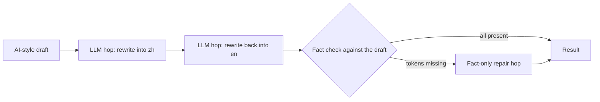

<div align="center">


# not-a-bot

**Get AI-assisted writing past readers, reviewers and AI detectors, with every fact intact.**

[Quick start](#quick-start) · [Measured results](#measured-results) · [Agent skill](#install) · [Docs](./docs/README.md) · English | [简体中文](./README.zh-cn.md)

[](#license)
[](https://www.npmjs.com/package/not-a-bot)
[](https://github.com/w21180239/not-a-bot/actions/workflows/ci.yml)
[](https://github.com/w21180239/not-a-bot/stargazers)

</div>

not-a-bot rewrites AI-assisted text until it reads like one person wrote it, then checks that every name, number and path survived. It runs on your own Claude Code or OpenCode subscription, so there is no API key and no extra bill. An offline linter and an agent skill catch the tells before a reader does.

## Before and after

An AI-style marketing paragraph (`nab lint`: 3 hits):

```text
CropSense Pro is the smart irrigation platform built for Waikato growers who want to do more with every drop. In the 2025-26 growing season, farms using CropSense Pro reduced water use by 27% while maintaining consistent yields, and the dashboard integrates seamlessly with the tools you already use. Our goal is to empower growers to unlock their full potential.
```

```bash
nab rewrite --from en --format json --quiet --preserve @code < draft.txt
```

```json
{
  "text": "CropSense Pro is a smart irrigation platform made for Waikato growers who want more out of every drop. In the 2025-26 growing season, farms using it cut their water use by 27% and held yields steady. The dashboard plugs straight into the tools you already use.",
  "chain": ["zh", "en", "fix"],
  "missingFacts": [],
  "provider": "opencode-cli",
  "latencyMs": 38844
}
```

The three stock words are gone, and so is the closing pledge, which says nothing a reader can use. CropSense Pro, Waikato, 2025-26 and 27% all survived, and `nab lint` finds 0 hits in the result.

<table>
<tr>
<td align="center" width="25%"><a href="#measured-results"><b>0.999 → 0.39</b><br/><sub>mean detector score, 30 texts</sub></a></td>
<td align="center" width="25%"><a href="#measured-results"><b>96%</b><br/><sub>of texts keep every fact</sub></a></td>
<td align="center" width="25%"><a href="#lint-offline-and-deterministic"><b>0</b><br/><sub>network calls for <code>nab lint</code></sub></a></td>
<td align="center" width="25%"><a href="#install"><b>1</b><br/><sub>binary, no runtime</sub></a></td>
</tr>
</table>

## Install

```bash
npm install -g not-a-bot
```

This puts `not-a-bot` and `nab` on your PATH (the two are the same binary). Without npm: `cargo install --git https://github.com/w21180239/not-a-bot` (Rust 1.89 or later), or a prebuilt binary from [GitHub Releases](https://github.com/w21180239/not-a-bot/releases/latest). `nab rewrite` calls `opencode run` by default; set `NOT_A_BOT_REWRITE_LLM=claude-cli` to use `claude -p` instead. Either CLI must be installed and signed in.

The agent skill teaches your coding agent the writing method, so its drafts need less rewriting:

```text
# Claude Code (plugin marketplace)
/plugin marketplace add w21180239/not-a-bot
/plugin install not-a-bot@not-a-bot
```

```bash
# Claude Code, Codex, Cursor, Gemini CLI, OpenCode and other agents that read skills
npx skills add w21180239/not-a-bot

# or copy the folder yourself
mkdir -p ~/.claude/skills/not-a-bot && cp -r integrations/skill/not-a-bot/. ~/.claude/skills/not-a-bot/
```

Paths for each agent are in [integrations/README.md](./integrations/README.md).

## Quick start

```bash
# Rewrite a draft (default preset: standard)
nab rewrite --from en --preserve @code < draft.md

# Lowest detector score, may drop a fact (reported in missingFacts)
nab rewrite --from en --preset strong < draft.md

# Check a rewrite against its source; exit 1 on any tell or lost fact
nab lint rewrite.md --source draft.md --strict

# Translate, no key needed
nab translate "Deploy failed" -t ja
```

To gate commits or CI on the linter:

```bash
# .git/hooks/pre-commit
for f in $(git diff --cached --name-only -- '*.md'); do nab lint "$f" --strict || exit 1; done
```

```yaml
# GitHub Actions step
- run: npm install -g not-a-bot && nab lint README.md --strict
```

| Preset | What runs | Use it for |
| --- | --- | --- |
| `standard` (default) | LLM out to another language, LLM back, then a fact-only repair hop that is told which tokens went missing | Most text. Lowest fact loss. |
| `strong` | LLM out and back, no repair hop | The lowest detector score. May drop a fact, which is reported. |
| `light` | Two free machine-translation hops | A quick pass with no subscription. Words change, sentence shapes stay. |

Pass `--preserve @code` and `--preserve @url` to keep code spans and links verbatim. Do not round-trip legal text, API reference or numbers a reader will check line by line.

## How it works

Translating into another language and back forces the sentences to be rebuilt, so the stock phrasing of generated text does not return unchanged. In `standard` and `strong` both hops are LLM calls told to rewrite like a person. They also cut sentences that only express feelings, pledges or pleasantries, which is where much of a draft's AI voice sits.



The fact check compares names, numbers, versions, paths, IDs and code spans with the source. Whatever is still missing at the end comes back in `missingFacts`, so a lost fact is reported rather than shipped silently.

### Lint: offline and deterministic

`nab lint` needs no network and no model. It flags AI vocabulary, stock phrases, staged contrasts ("not just X, it's Y"), em dashes, bold-label bullets and US spellings. With `--source` it also lists the names, numbers, paths and IDs a draft lost or gained. The same input gives the same output every time, so it works as a pre-commit or CI check.

## Measured results

`benches/prompt-lab`: 30 synthetic AI-style English workplace texts (customer emails, Slack updates, marketing blurbs, documentation, LinkedIn posts), run through the real binary, 2 to 3 samples per configuration. Each output is scored by `desklib/ai-text-detector-v1.01`; the score is P(AI), higher means more AI-like. Facts are exact, case-sensitive token matches against the source.

| Configuration | Mean P(AI) | Outputs below 0.5 | Texts with a lost fact token (of 30) | Latency on opencode |
| --- | --- | --- | --- | --- |
| Source texts | 0.999 | 0% | n/a | n/a |
| Earlier prompt | 0.579 | 43% | 2.3 | n/a |
| `standard` | 0.387 | 63% | 1.3 | about 70 s |
| `strong` | 0.367 | 68% | 2.0 | about 30 s |

`standard` keeps about 99.6% of fact tokens. Method, per-variant tables and failed experiments: [benches/prompt-lab](./benches/prompt-lab/README.md). A second bench on 8 texts is in [benches/rewrite-depth](./benches/rewrite-depth/README.md).

What this does not show:

- It is one detector. Detectors disagree with each other and change between versions, and no tool makes text reliably undetectable. A score under 0.5 on this detector says nothing about another.
- 37% of `standard` outputs still score above 0.5.
- The corpus is synthetic and in English only. The LLM hops shorten text by about 30% because they cut pleasantries and pledges.
- Latency depends on your model and plan. The 60-word paragraph above took 39 s.

## How it compares

| | not-a-bot | [blader/humanizer](https://github.com/blader/humanizer) | AI humanizer web apps |
| --- | --- | --- | --- |
| Form | CLI and agent skill | Prompt-only agent skill | Hosted website, some with a paid API |
| Checks that facts survived | Yes: `missingFacts`, `lint --source` | No | No |
| Offline AI-tell lint | Yes | No | No |
| Scriptable, CI exit codes | Yes | No | Rarely |
| Runs on your own subscription | Yes | Yes, in your agent | No, their service and credits |
| Open source | Yes | Yes (MIT) | Mostly no |
| Detector numbers with method | Yes, one detector, bench in the repo | None; its README says it does not target detectors | Vendor claims |

blader/humanizer needs no install beyond one skill file and is the more thorough reference for how AI prose reads; much of this project's tell catalogue is adapted from it. Pick it when you want a prompt and nothing else. Pick not-a-bot when a script or a reviewer has to see that the facts held.

## Agent integrations

<div align="center">
<table>
<tr>
<td align="center" width="150"><br/><b>Claude Code</b><br/><sub>skill · plugin</sub></td>
<td align="center" width="150"><br/><b>Codex CLI</b><br/><sub>skill · AGENTS.md</sub></td>
<td align="center" width="150"><br/><b>Cursor</b><br/><sub>.cursor/rules</sub></td>
<td align="center" width="150"><br/><b>Gemini CLI</b><br/><sub>skill · GEMINI.md</sub></td>
</tr>
<tr>
<td align="center"><br/><b>OpenCode</b><br/><sub>skill · AGENTS.md</sub></td>
<td align="center"><br/><b>Cline</b><br/><sub>.clinerules</sub></td>
<td align="center"><br/><b>Zed</b><br/><sub>.rules</sub></td>
<td align="center"><br/><b>Aider</b><br/><sub>CONVENTIONS.md</sub></td>
</tr>
</table>
</div>

Also Roo Code, Kilo Code, Continue, JetBrains AI, Qwen Code, Crush, Goose and 9 more: 24 harnesses in all, each with its own file path in [integrations/README.md](./integrations/README.md). Anything that can run a shell can call the CLI directly. The integration is a command and one document, with no server and no protocol.

For agents, every command takes `--format json`, and every failure carries `code`, `retryable` and `suggestedAction`. Exit codes are `0` success, `1` request error, `2` config error, `3` chain exhausted, `4` network error. The contract is in [AGENTS.md](./AGENTS.md) and [docs/en/api](./docs/en/api/OVERVIEW.md); `nab schema` prints the JSON Schema.

## Configuration

`~/.config/not-a-bot/config.toml`, or `NOT_A_BOT_CONFIG`:

```toml
rewrite_preset = "standard"     # light, standard, strong
rewrite_llm = "opencode-cli"    # or "claude-cli"
```

Environment variables `NOT_A_BOT_REWRITE_PRESET` and `NOT_A_BOT_REWRITE_LLM` override both. More: [config files](./docs/en/cli/02-config-files.md), [environment variables](./docs/en/env/01-variables.md).

## Translate too

`nab translate` is a keyless translator: 28 engines, 14 of them free web endpoints (Google, Edge, Papago, Sogou and others) that race three at a time, with JSON output and typed errors. `light` rewrites use the same engines. Providers, priorities and live status: [docs/en/providers](./docs/en/providers/01-supported-providers.md).

## Documentation

| Topic | Where |
| --- | --- |
| Rewrite chains, presets, repair hop | [docs/en/rewrite/OVERVIEW.md](./docs/en/rewrite/OVERVIEW.md) |
| CLI commands | [docs/en/cli/01-commands.md](./docs/en/cli/01-commands.md) |
| JSON and errors | [docs/en/api/OVERVIEW.md](./docs/en/api/OVERVIEW.md) |
| Providers | [docs/en/providers/OVERVIEW.md](./docs/en/providers/OVERVIEW.md) |
| Troubleshooting | [docs/en/troubleshooting/OVERVIEW.md](./docs/en/troubleshooting/OVERVIEW.md) |
| Changelog | [docs/en/CHANGELOG.md](./docs/en/CHANGELOG.md) |

## Contributing

Issues and pull requests are welcome. Run `cargo test` and `cargo clippy --all-targets` before opening one. To add a translation provider, follow [docs/en/providers/03-adding-a-provider.md](./docs/en/providers/03-adding-a-provider.md). For a rewrite change, add a prompt-lab variant and report the detector numbers with the method.

## License

Licensed under either of [Apache License 2.0](./LICENSE-APACHE) or [MIT](./LICENSE-MIT) at your option.

## Credits

The tell catalogue draws on [blader/humanizer](https://github.com/blader/humanizer) (MIT, Siqi Chen) and Wikipedia's [Signs of AI writing](https://en.wikipedia.org/wiki/Wikipedia:Signs_of_AI_writing). Detector scores come from [desklib/ai-text-detector-v1.01](https://huggingface.co/desklib/ai-text-detector-v1.01). not-a-bot continues translatex 0.3.0 under a new name. Logos belong to their projects.
