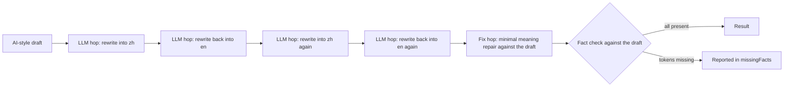

<div align="center">


# not-a-bot

**Get AI-assisted writing past readers, reviewers and AI detectors, with every fact intact.**

[Quick start](#quick-start) · [Measured results](#measured-results) · [Agent skill](#install) · [Docs](./docs/README.md) · English | [简体中文](./README.zh-cn.md)

[](#license)
[](https://www.npmjs.com/package/not-a-bot-cli)
[](https://github.com/w21180239/not-a-bot/actions/workflows/ci.yml)
[](https://github.com/w21180239/not-a-bot/stargazers)

</div>

not-a-bot rewrites AI-assisted text until it reads like one person wrote it, then checks that every name, number and path survived. It runs on your own Claude Code or OpenCode subscription, so there is no API key and no extra bill. An offline linter and an agent skill catch the tells before a reader does.

## Before and after

An AI-style marketing paragraph (`nab lint`: 3 hits):

```text
CropSense Pro is the smart irrigation platform built for Waikato growers who want to do more with every drop. In the 2025-26 growing season, farms using CropSense Pro reduced water use by 27% while maintaining consistent yields, and the dashboard integrates seamlessly with the tools you already use. Our goal is to empower growers to unlock their full potential.
```

```bash
nab rewrite --from en --format json --quiet --preserve @code < draft.txt
```

```json
{
  "text": "CropSense Pro is a smart irrigation platform made for Waikato growers who want more out of every drop. In the 2025-26 growing season, farms using it cut their water use by 27% and held yields steady. The dashboard plugs straight into the tools you already use.",
  "chain": ["zh", "en", "fix"],
  "missingFacts": [],
  "provider": "opencode-cli",
  "latencyMs": 38844
}
```

The three stock words are gone, and so is the closing pledge, which says nothing a reader can use. CropSense Pro, Waikato, 2025-26 and 27% all survived, and `nab lint` finds 0 hits in the result.

<table>
<tr>
<td align="center" width="25%"><a href="#measured-results"><b>0.999 → 0.36</b><br/><sub>mean detector score, 30 texts</sub></a></td>
<td align="center" width="25%"><a href="#measured-results"><b>98%</b><br/><sub>of texts with no major meaning error</sub></a></td>
<td align="center" width="25%"><a href="#lint-offline-and-deterministic"><b>0</b><br/><sub>network calls for <code>nab lint</code></sub></a></td>
<td align="center" width="25%"><a href="#install"><b>1</b><br/><sub>binary, no runtime</sub></a></td>
</tr>
</table>

## Install

```bash
npm install -g not-a-bot-cli
```

This puts `not-a-bot` and `nab` on your PATH (the two are the same binary). Without npm: `cargo install --git https://github.com/w21180239/not-a-bot` (Rust 1.89 or later), or a prebuilt binary from [GitHub Releases](https://github.com/w21180239/not-a-bot/releases/latest). `nab rewrite` calls `opencode run` by default; set `NOT_A_BOT_REWRITE_LLM=claude-cli` to use `claude -p` instead. Either CLI must be installed and signed in.

The agent skill teaches your coding agent the writing method, so its drafts need less rewriting:

```text
# Claude Code (plugin marketplace)
/plugin marketplace add w21180239/not-a-bot
/plugin install not-a-bot@not-a-bot
```

```bash
# Claude Code, Codex, Cursor, Gemini CLI, OpenCode and other agents that read skills
npx skills add w21180239/not-a-bot

# or copy the folder yourself
mkdir -p ~/.claude/skills/not-a-bot && cp -r integrations/skill/not-a-bot/. ~/.claude/skills/not-a-bot/
```

Paths for each agent are in [integrations/README.md](./integrations/README.md).

## Quick start

```bash
# Rewrite a draft (default preset: standard)
nab rewrite --from en --preserve @code < draft.md

# Cheapest rewrite: one round trip (3 LLM calls)
nab rewrite --from en --preset light < draft.md

# Lowest detector score: best of 5 standard runs, picked by a scorer (needs one)
nab rewrite --from en --preset strong --scorer benches/detector/scorer-e5raid.sh < draft.md

# Check a rewrite against its source; exit 1 on any tell or lost fact
nab lint rewrite.md --source draft.md --strict

# Translate, no key needed
nab translate "Deploy failed" -t ja
```

To gate commits or CI on the linter:

```bash
# .git/hooks/pre-commit
for f in $(git diff --cached --name-only -- '*.md'); do nab lint "$f" --strict || exit 1; done
```

```yaml
# GitHub Actions step
- run: npm install -g not-a-bot-cli && nab lint README.md --strict
```

| Preset | What runs | Use it for |
| --- | --- | --- |
| `light` | One round trip: LLM out to another language, LLM back rewriting freely, then a minimal meaning-repair hop. 3 LLM calls. | Short or low-stakes text, and the lowest cost. |
| `standard` (default) | Two round trips: LLM out, LLM back, LLM out, LLM back, then the repair hop. 5 LLM calls, about 1.7x the cost of `light`. | Most text. |
| `strong` | The `standard` chain run best-of-5, keeping the lowest-scoring run. Up to 25 LLM calls, about 8.5x the cost of `light`. Needs a scorer (`--scorer` or config `rewrite_scorer`), else it fails with `INVALID_INPUT` before running anything. | Text where the detector score matters most and you can run a scorer. |

All three presets need an LLM (`rewrite_llm`, default `opencode-cli`, or `claude-cli`) and make several LLM calls, tens of seconds to minutes in total. No return hop sees the original; only the repair hops do. No preset uses machine translation. `--best-of` overrides the default of 5 for `strong`.

`strong` selects by a detector, so its gains are mostly against that detector. A second, held-out detector moves much less, and meaning errors are somewhat higher. The repo ships `benches/detector/scorer-e5raid.sh` and `scorer-e5raid.cmd`: a stdin scorer built on the e5-small RAID detector `MayZhou/e5-small-lora-ai-generated-detector`, using the same venv as the desklib `scorer.sh`. Presets before 0.4.0 differed: see the [changelog](./docs/en/CHANGELOG.md).

Pass `--preserve @code` and `--preserve @url` to keep code spans and links verbatim. Do not round-trip legal text, API reference or numbers a reader will check line by line.

## How it works

Translating into another language and back forces the sentences to be rebuilt, so the stock phrasing of generated text does not return unchanged. `standard` makes two round trips, so every hop is an LLM call told to rewrite like a person. The return hops do not see the original and may reorder sentences within a paragraph. They also cut sentences that only express feelings, pledges or pleasantries, which is where much of a draft's AI voice sits.



`light` skips the second round trip. `strong` runs the whole chain five times and keeps the run the scorer rates lowest.

Every preset ends with a fix hop: an LLM that sees the original and returns small JSON span edits restoring meaning that earlier hops lost or changed (names, numbers, dates, amounts, IDs, code spans, flipped negations, changed qualifiers or certainty, changed actor, cause or order, dropped or invented claims). It checks the original paragraph by paragraph for dropped claims. Fact edits always apply; other edits share one copy-back budget. It never restores deliberately cut feeling, pledge or pleasantry sentences, and never moves wording back toward the original. It also receives the fact check's list of missing tokens.

The fact check compares names, numbers, versions, paths, IDs and code spans with the source. Whatever is still missing at the end comes back in `missingFacts`, so a lost fact is reported rather than shipped silently.

### Lint: offline and deterministic

`nab lint` needs no network and no model. It flags AI vocabulary, stock phrases, staged contrasts ("not just X, it's Y"), em dashes, bold-label bullets and US spellings. With `--source` it also lists the names, numbers, paths and IDs a draft lost or gained. The same input gives the same output every time, so it works as a pre-commit or CI check.

## Measured results

`benches/prompt-lab`: 30 synthetic AI-style English workplace texts (customer emails, Slack updates, marketing blurbs, documentation, LinkedIn posts), run through the real binary, 2 samples per configuration. Each output is scored by `desklib/ai-text-detector-v1.01`; the score is P(AI), higher means more AI-like. Fact loss is the number of texts (of 30) missing at least one exact, case-sensitive fact token. Meaning is judged per text by Claude Sonnet: the share of texts with no major meaning error.

| Configuration | Mean P(AI) | Fact loss (of 30) | No major meaning error |
| --- | --- | --- | --- |
| Source texts | 0.999 | n/a | n/a |
| `light` (LLM out, free LLM back, fix; `standard` before 0.4.0) | 0.364 | 0.5 | 98% |
| Google out, fix, LLM back, fix (`light` before 0.4.0, removed) | 0.489 | 0 | 97% |
| Google out, LLM back, one final fix | 0.515 | 0 | 87% |
| 2 machine-translation hops and a final fix | 0.930 | 5.0 | 80% |

Machine translation changes words but keeps sentence structure, so machine-only chains stay near the source score even with repairs; the score drop comes from the LLM rewrite hop. In this run no chain that cost more than the LLM-out, LLM-back, fix chain scored lower; the 0.4.0 presets below test that again. Method, the full table and failed experiments: [benches/prompt-lab](./benches/prompt-lab/README.md). A second bench on 8 texts is in [benches/rewrite-depth](./benches/rewrite-depth/README.md).

### The 0.4.0 presets

Mean P(AI) from `desklib/ai-text-detector-v1.01`, lower is more human. Three sets: corpus30 is the 30 `benches/prompt-lab` texts, hb40 is 40 AI-written workplace texts, aeslc30 is 30 human-written Enron emails. Ranges are across repeat runs. `strong` used the e5raid scorer as its selector, so desklib is a held-out detector for it.

| Preset | corpus30 | hb40 | aeslc30 | Relative cost |
| --- | --- | --- | --- | --- |
| `light` | ~0.54 | ~0.88 | ~0.24 | 1x |
| `standard` | 0.48-0.54 | 0.86-0.89 | 0.18-0.24 | ~1.7x |
| `strong` | 0.37-0.41 | 0.80-0.86 | 0.15-0.17 | ~8.5x |

`standard` and `light` overlap within the run-to-run range on every set. `strong` is lower on all three, with the largest gap on corpus30 and a small one on hb40.

### From 0.3.0 to 0.4.0

Between 0.3.0 and 0.4.0 about 60 candidates ran on these three sets, each changing one thing and each checked against a same-day baseline, a held-out detector and a meaning review. The ones that lowered scores without adding meaning errors shipped as 0.3.1 to 0.3.9 and as the 0.4.0 presets. Means over repeat runs (2 to 4 per row):

| Version | desklib corpus30 | desklib hb40 | desklib aeslc30 | held-out corpus30 | held-out hb40 | held-out aeslc30 |
| --- | --- | --- | --- | --- | --- | --- |
| 0.3.0 `standard` | 0.985 | 0.998 | 0.319 | - | - | - |
| 0.3.8 `standard` | - | 0.88 | - | 0.573 | 0.681 | 0.127 |
| 0.3.9 `standard` (now `light`) | 0.536 | 0.882 | 0.241 | - | - | - |
| 0.4.0 `standard` | **0.509** | **0.877** | **0.208** | **0.504** | **0.672** | **0.064** |
| 0.4.0 `strong` | **0.387** | **0.831** | **0.160** | **0.467** | **0.651** | **0.054** |

Against 0.3.0 on desklib, `standard` is 48% lower on corpus30, 35% lower on aeslc30 and 12% lower on hb40; `strong` is 61%, 50% and 17% lower. The held-out detector (`SuperAnnotate/ai-detector`, never used to pick outputs) moves the same way for `standard`, which is why its gain is not tuned to desklib. Core facts lost outside pleasantry sentences: 0 on every set for both presets.

0.3.0 scored close to the untouched source because its drift guard put whole original paragraphs back whenever a capitalised word seemed missing. Most of the 0.3.x gain comes from narrowing that guard: sentence-start verbs and positional capitals stopped counting as lost names, and it restores only the sentence group that drifted. 0.4.0 adds the second round trip, sentence reordering within a paragraph, and a paragraph-by-paragraph check for dropped claims in the fix hop.

What this does not show:

- It is one detector. Detectors disagree with each other and change between versions, and no tool makes text reliably undetectable. A score under 0.5 on this detector says nothing about another.
- The corpus is synthetic and in English only. The LLM hops shorten text because they cut pleasantries and pledges.
- Latency depends on your model and plan. `light` makes 3 LLM calls, `standard` 5 and `strong` up to 25, so `strong` can take minutes.

## How it compares

| | not-a-bot | [blader/humanizer](https://github.com/blader/humanizer) | AI humanizer web apps |
| --- | --- | --- | --- |
| Form | CLI and agent skill | Prompt-only agent skill | Hosted website, some with a paid API |
| Checks that facts survived | Yes: `missingFacts`, `lint --source` | No | No |
| Offline AI-tell lint | Yes | No | No |
| Scriptable, CI exit codes | Yes | No | Rarely |
| Runs on your own subscription | Yes | Yes, in your agent | No, their service and credits |
| Open source | Yes | Yes (MIT) | Mostly no |
| Detector numbers with method | Yes, one detector, bench in the repo | None; its README says it does not target detectors | Vendor claims |

blader/humanizer needs no install beyond one skill file and is the more thorough reference for how AI prose reads; much of this project's tell catalogue is adapted from it. Pick it when you want a prompt and nothing else. Pick not-a-bot when a script or a reviewer has to see that the facts held.

## Agent integrations

<div align="center">
<table>
<tr>
<td align="center" width="150"><br/><b>Claude Code</b><br/><sub>skill · plugin</sub></td>
<td align="center" width="150"><br/><b>Codex CLI</b><br/><sub>skill · AGENTS.md</sub></td>
<td align="center" width="150"><br/><b>Cursor</b><br/><sub>.cursor/rules</sub></td>
<td align="center" width="150"><br/><b>Gemini CLI</b><br/><sub>skill · GEMINI.md</sub></td>
</tr>
<tr>
<td align="center"><br/><b>OpenCode</b><br/><sub>skill · AGENTS.md</sub></td>
<td align="center"><br/><b>Cline</b><br/><sub>.clinerules</sub></td>
<td align="center"><br/><b>Zed</b><br/><sub>.rules</sub></td>
<td align="center"><br/><b>Aider</b><br/><sub>CONVENTIONS.md</sub></td>
</tr>
</table>
</div>

Also Roo Code, Kilo Code, Continue, JetBrains AI, Qwen Code, Crush, Goose and 9 more: 24 harnesses in all, each with its own file path in [integrations/README.md](./integrations/README.md). Anything that can run a shell can call the CLI directly. The integration is a command and one document, with no server and no protocol.

For agents, every command takes `--format json`, and every failure carries `code`, `retryable` and `suggestedAction`. Exit codes are `0` success, `1` request error, `2` config error, `3` chain exhausted, `4` network error. The contract is in [AGENTS.md](./AGENTS.md) and [docs/en/api](./docs/en/api/OVERVIEW.md); `nab schema` prints the JSON Schema.

## Configuration

`~/.config/not-a-bot/config.toml`, or `NOT_A_BOT_CONFIG`:

```toml
rewrite_preset = "standard"     # light, standard, strong
rewrite_llm = "opencode-cli"    # or "claude-cli"
# rewrite_scorer = "benches/detector/scorer-e5raid.sh"   # required by the strong preset
```

Environment variables `NOT_A_BOT_REWRITE_PRESET` and `NOT_A_BOT_REWRITE_LLM` override the first two. More: [config files](./docs/en/cli/02-config-files.md), [environment variables](./docs/en/env/01-variables.md).

## Translate too

`nab translate` is a keyless translator: 28 engines, 14 of them free web endpoints (Google, Edge, Papago, Sogou and others) that race three at a time, with JSON output and typed errors. Rewrite presets do not use them; they are LLM-only. Providers, priorities and live status: [docs/en/providers](./docs/en/providers/01-supported-providers.md).

## Documentation

| Topic | Where |
| --- | --- |
| Rewrite chains, presets, repair hop | [docs/en/rewrite/OVERVIEW.md](./docs/en/rewrite/OVERVIEW.md) |
| CLI commands | [docs/en/cli/01-commands.md](./docs/en/cli/01-commands.md) |
| JSON and errors | [docs/en/api/OVERVIEW.md](./docs/en/api/OVERVIEW.md) |
| Providers | [docs/en/providers/OVERVIEW.md](./docs/en/providers/OVERVIEW.md) |
| Troubleshooting | [docs/en/troubleshooting/OVERVIEW.md](./docs/en/troubleshooting/OVERVIEW.md) |
| Changelog | [docs/en/CHANGELOG.md](./docs/en/CHANGELOG.md) |

## Contributing

Issues and pull requests are welcome. Run `cargo test` and `cargo clippy --all-targets` before opening one. To add a translation provider, follow [docs/en/providers/03-adding-a-provider.md](./docs/en/providers/03-adding-a-provider.md). For a rewrite change, add a prompt-lab variant and report the detector numbers with the method.

## License

Licensed under either of [Apache License 2.0](./LICENSE-APACHE) or [MIT](./LICENSE-MIT) at your option.

## Credits

The tell catalogue draws on [blader/humanizer](https://github.com/blader/humanizer) (MIT, Siqi Chen) and Wikipedia's [Signs of AI writing](https://en.wikipedia.org/wiki/Wikipedia:Signs_of_AI_writing). Detector scores come from [desklib/ai-text-detector-v1.01](https://huggingface.co/desklib/ai-text-detector-v1.01). not-a-bot continues translatex 0.3.0 under a new name. Logos belong to their projects.
