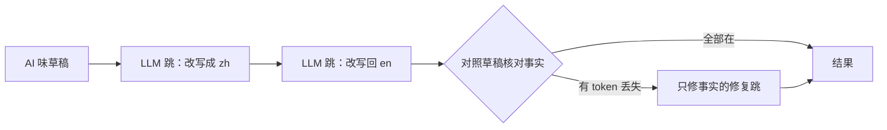

<div align="center">


# not-a-bot

**让 AI 辅助写出来的文字经得住读者、评审和 AI 检测器的审视，事实一个不丢。**

[快速开始](#快速开始) · [实测结果](#实测结果) · [Agent skill](#安装) · [文档](./docs/README.md) · [English](./README.md) | 简体中文

[](#许可)
[](https://www.npmjs.com/package/not-a-bot-cli)
[](https://github.com/w21180239/not-a-bot/actions/workflows/ci.yml)
[](https://github.com/w21180239/not-a-bot/stargazers)

</div>

not-a-bot 把 AI 辅助写出的文字改到读起来像同一个人写的，再核对每个人名、数字和路径是否还在。它用你自己的 Claude Code 或 OpenCode 订阅，不需要 API Key，也没有额外账单。离线 lint 和 agent skill 负责在读者发现之前把 AI 味挑出来。

## 改写前后

一段典型的 AI 味营销文案（`nab lint`：3 处命中）：

```text
CropSense Pro is the smart irrigation platform built for Waikato growers who want to do more with every drop. In the 2025-26 growing season, farms using CropSense Pro reduced water use by 27% while maintaining consistent yields, and the dashboard integrates seamlessly with the tools you already use. Our goal is to empower growers to unlock their full potential.
```

```bash
nab rewrite --from en --format json --quiet --preserve @code < draft.txt
```

```json
{
  "text": "CropSense Pro is a smart irrigation platform made for Waikato growers who want more out of every drop. In the 2025-26 growing season, farms using it cut their water use by 27% and held yields steady. The dashboard plugs straight into the tools you already use.",
  "chain": ["zh", "en", "fix"],
  "missingFacts": [],
  "provider": "opencode-cli",
  "latencyMs": 38844
}
```

三个套话词没了，结尾那句对读者没有用的表态也删掉了。CropSense Pro、Waikato、2025-26 和 27% 都还在，结果再跑 `nab lint` 是 0 处命中。

<table>
<tr>
<td align="center" width="25%"><a href="#实测结果"><b>0.999 → 0.39</b><br/><sub>检测器平均得分，30 篇文本</sub></a></td>
<td align="center" width="25%"><a href="#实测结果"><b>96%</b><br/><sub>的文本事实全部保留</sub></a></td>
<td align="center" width="25%"><a href="#lint离线且结果确定"><b>0</b><br/><sub><code>nab lint</code> 的网络请求数</sub></a></td>
<td align="center" width="25%"><a href="#安装"><b>1</b><br/><sub>个二进制，无运行时依赖</sub></a></td>
</tr>
</table>

## 安装

```bash
npm install -g not-a-bot-cli
```

装完 PATH 上有 `not-a-bot` 和 `nab`，两者是同一个二进制。不用 npm 的话：`cargo install --git https://github.com/w21180239/not-a-bot`（Rust 1.89 以上），或者到 [GitHub Releases](https://github.com/w21180239/not-a-bot/releases/latest) 下载预编译二进制。`nab rewrite` 默认调用 `opencode run`；设置 `NOT_A_BOT_REWRITE_LLM=claude-cli` 就改用 `claude -p`。两个 CLI 之一需要已安装并登录。

agent skill 把写作方法教给你的编程 agent，让它起草的文字少改几轮：

```text
# Claude Code（plugin marketplace）
/plugin marketplace add w21180239/not-a-bot
/plugin install not-a-bot@not-a-bot
```

```bash
# Claude Code、Codex、Cursor、Gemini CLI、OpenCode 等能读 skill 的 agent
npx skills add w21180239/not-a-bot

# 或者自己复制目录
mkdir -p ~/.claude/skills/not-a-bot && cp -r integrations/skill/not-a-bot/. ~/.claude/skills/not-a-bot/
```

各 agent 的具体路径见 [integrations/README.md](./integrations/README.md)。

## 快速开始

```bash
# 改写草稿（默认预设 standard）
nab rewrite --from en --preserve @code < draft.md

# 检测器得分最低，可能丢事实（会列在 missingFacts 里）
nab rewrite --from en --preset strong < draft.md

# 拿改写结果对照原文检查；有 AI 味或丢事实就以退出码 1 结束
nab lint rewrite.md --source draft.md --strict

# 翻译，不需要 Key
nab translate "Deploy failed" -t ja
```

想让提交或 CI 卡住 AI 味：

```bash
# .git/hooks/pre-commit
for f in $(git diff --cached --name-only -- '*.md'); do nab lint "$f" --strict || exit 1; done
```

```yaml
# GitHub Actions 步骤
- run: npm install -g not-a-bot-cli && nab lint README.md --strict
```

| 预设 | 执行内容 | 适用场景 |
| --- | --- | --- |
| `standard`（默认） | LLM 译出到另一种语言，LLM 译回，再跑一跳只修事实的修复，修复时会告知丢了哪些 token | 大多数文本，事实丢失最少 |
| `strong` | LLM 译出再译回，不做修复 | 检测器得分最低，可能丢事实，丢了会报告 |
| `light` | 两跳免费机器翻译 | 不用订阅的快速一遍，词会变，句式不变 |

`--preserve @code` 和 `--preserve @url` 让代码片段和链接原样保留。法律文本、API 参考，以及读者会逐行核对的数字，不要做往返改写。

## 原理

译成另一种语言再译回来，句子会被重新组织，所以生成文本的套话不会原样回来。`standard` 和 `strong` 的两跳都是 LLM 调用，要求它们像人一样改写，同时删掉只表达感受、表态或客套的句子，AI 味有不少就藏在这些句子里。



事实核对会拿人名、数字、版本号、路径、ID 和代码片段与原文比对。最后仍然缺的会出现在 `missingFacts` 里，丢了什么是明确报告的，不会悄悄交付。

### Lint：离线且结果确定

`nab lint` 不联网，也不调用模型。它标出 AI 常用词、套话、刻意的对比句式（"不仅……更是……"、"not just X, it's Y"）、破折号、加粗标签式列表和美式拼写。加上 `--source` 后，还会列出草稿丢掉或新增的人名、数字、路径和 ID。同样的输入永远得到同样的输出，所以适合放进 pre-commit 或 CI。

## 实测结果

`benches/prompt-lab`：30 篇合成的 AI 味英文职场文本（客户邮件、Slack 更新、营销文案、文档、LinkedIn 帖子），用真实二进制跑，每种配置 2 到 3 个样本。每条输出由 `desklib/ai-text-detector-v1.01` 打分，分数是 P(AI)，越高越像 AI。事实按 token 精确、区分大小写地对照原文。

| 配置 | 平均 P(AI) | 得分低于 0.5 的输出 | 丢过事实 token 的文本（共 30） | opencode 延迟 |
| --- | --- | --- | --- | --- |
| 原文 | 0.999 | 0% | 无 | 无 |
| 早期 prompt | 0.579 | 43% | 2.3 | 无 |
| `standard` | 0.387 | 63% | 1.3 | 约 70 秒 |
| `strong` | 0.367 | 68% | 2.0 | 约 30 秒 |

`standard` 保留了约 99.6% 的事实 token。方法、各变体的表格和失败的实验见 [benches/prompt-lab](./benches/prompt-lab/README.md)。另有一个 8 篇文本的测试在 [benches/rewrite-depth](./benches/rewrite-depth/README.md)。

这些数据没有说明的事：

- 这只是一个检测器。检测器之间会有分歧，版本之间也会变，没有任何工具能让文本稳定地检测不出。在这个检测器上低于 0.5，不代表在别的检测器上也低。
- `standard` 仍有 37% 的输出得分在 0.5 以上。
- 语料是合成的，只有英文。LLM 跳会把文本缩短约 30%，因为它们删掉了客套和表态。
- 延迟取决于你的模型和套餐。上面那段 60 个词的文案用了 39 秒。

## 横向对比

| | not-a-bot | [blader/humanizer](https://github.com/blader/humanizer) | AI 改写网站 |
| --- | --- | --- | --- |
| 形态 | CLI 加 agent skill | 只有 prompt 的 agent skill | 在线网站，部分提供付费 API |
| 核对事实是否保留 | 有：`missingFacts`、`lint --source` | 无 | 无 |
| 离线 AI 味检查 | 有 | 无 | 无 |
| 可脚本化，带 CI 退出码 | 有 | 无 | 很少 |
| 用你自己的订阅跑 | 是 | 是，在你的 agent 里 | 否，用他们的服务和额度 |
| 开源 | 是 | 是（MIT） | 多数不是 |
| 带方法的检测器数据 | 有，一个检测器，测试在仓库里 | 没有；它的 README 说明不针对检测器 | 厂商自述 |

blader/humanizer 只要一个 skill 文件，不需要额外安装，对 AI 文风的描述也更细，本项目的 AI 味清单有不少改编自它。只想要一份 prompt 的话选它。脚本或评审需要看到事实没丢的话选 not-a-bot。

## Agent 集成

<div align="center">
<table>
<tr>
<td align="center" width="150"><br/><b>Claude Code</b><br/><sub>skill · plugin</sub></td>
<td align="center" width="150"><br/><b>Codex CLI</b><br/><sub>skill · AGENTS.md</sub></td>
<td align="center" width="150"><br/><b>Cursor</b><br/><sub>.cursor/rules</sub></td>
<td align="center" width="150"><br/><b>Gemini CLI</b><br/><sub>skill · GEMINI.md</sub></td>
</tr>
<tr>
<td align="center"><br/><b>OpenCode</b><br/><sub>skill · AGENTS.md</sub></td>
<td align="center"><br/><b>Cline</b><br/><sub>.clinerules</sub></td>
<td align="center"><br/><b>Zed</b><br/><sub>.rules</sub></td>
<td align="center"><br/><b>Aider</b><br/><sub>CONVENTIONS.md</sub></td>
</tr>
</table>
</div>

另外还有 Roo Code、Kilo Code、Continue、JetBrains AI、Qwen Code、Crush、Goose 等 9 个，一共 24 个 harness，各自的文件路径都在 [integrations/README.md](./integrations/README.md)。能跑 shell 的工具也可以直接调用 CLI。集成方式就是一条命令加一份文档，没有 server，也没有协议。

给 agent 用时，每条命令都支持 `--format json`，每个失败都带 `code`、`retryable` 和 `suggestedAction`。退出码：`0` 成功，`1` 请求错误，`2` 配置错误，`3` 链路耗尽，`4` 网络错误。契约见 [AGENTS.md](./AGENTS.md) 和 [docs/zh-cn/api](./docs/zh-cn/api/OVERVIEW.md)；`nab schema` 会输出 JSON Schema。

## 配置

`~/.config/not-a-bot/config.toml`，或用 `NOT_A_BOT_CONFIG` 指定：

```toml
rewrite_preset = "standard"     # light, standard, strong
rewrite_llm = "opencode-cli"    # 或 "claude-cli"
```

环境变量 `NOT_A_BOT_REWRITE_PRESET` 和 `NOT_A_BOT_REWRITE_LLM` 会覆盖这两项。更多见[配置文件](./docs/zh-cn/cli/02-config-files.md)和[环境变量](./docs/zh-cn/env/01-variables.md)。

## 也能翻译

`nab translate` 是不需要 Key 的翻译器：28 个引擎，其中 14 个是免费网页接口（Google、Edge、Papago、搜狗等），每次三个并发竞速，输出 JSON，错误带类型。`light` 改写用的也是这些引擎。Provider、优先级和实测状态见 [docs/zh-cn/providers](./docs/zh-cn/providers/01-supported-providers.md)。

## 文档

| 主题 | 位置 |
| --- | --- |
| 改写链路、预设、修复跳 | [docs/zh-cn/rewrite/OVERVIEW.md](./docs/zh-cn/rewrite/OVERVIEW.md) |
| CLI 命令 | [docs/zh-cn/cli/01-commands.md](./docs/zh-cn/cli/01-commands.md) |
| JSON 与错误 | [docs/zh-cn/api/OVERVIEW.md](./docs/zh-cn/api/OVERVIEW.md) |
| Provider | [docs/zh-cn/providers/OVERVIEW.md](./docs/zh-cn/providers/OVERVIEW.md) |
| 故障排查 | [docs/zh-cn/troubleshooting/OVERVIEW.md](./docs/zh-cn/troubleshooting/OVERVIEW.md) |
| 更新日志 | [docs/zh-cn/CHANGELOG.md](./docs/zh-cn/CHANGELOG.md) |

## 参与贡献

欢迎提 issue 和 pull request。提交前运行 `cargo test` 和 `cargo clippy --all-targets`。新增翻译 provider 请按 [docs/zh-cn/providers/03-adding-a-provider.md](./docs/zh-cn/providers/03-adding-a-provider.md) 做。改动改写逻辑时，请加一个 prompt-lab 变体，并连同方法一起报告检测器数据。

## 许可

任选其一：[Apache License 2.0](./LICENSE-APACHE) 或 [MIT](./LICENSE-MIT)。

## 致谢

AI 味清单参考了 [blader/humanizer](https://github.com/blader/humanizer)（MIT，Siqi Chen）和维基百科的 [Signs of AI writing](https://en.wikipedia.org/wiki/Wikipedia:Signs_of_AI_writing)。检测器得分来自 [desklib/ai-text-detector-v1.01](https://huggingface.co/desklib/ai-text-detector-v1.01)。not-a-bot 是 translatex 0.3.0 换名后的延续。Logo 归各自项目所有。
