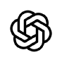
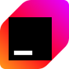
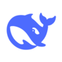
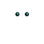

**English** · [简体中文](../../zh-cn/integrations/02-supported-harnesses.md)

# Supported harnesses

[← Integrations](OVERVIEW.md) · [Documentation index](../README.md)

A harness is the agent host: a terminal coding agent, an editor assistant, or a
chat client that runs commands. `not-a-bot` reaches 24 of them with two
documents — a skill for hosts that load skills, and an instructions block for
those that read project rules. Every harness also gets the CLI, which is the
actual integration.

<div align="center">
<table>
<tr>
<td align="center" width="150"><br/><b>Claude Code</b><br/><sub>skill · plugin</sub></td>
<td align="center" width="150"><br/><b>Codex CLI</b><br/><sub>skill · AGENTS.md</sub></td>
<td align="center" width="150"><br/><b>Gemini CLI</b><br/><sub>skill · GEMINI.md</sub></td>
<td align="center" width="150"><br/><b>OpenCode</b><br/><sub>skill · AGENTS.md</sub></td>
</tr>
<tr>
<td align="center"><br/><b>Cursor</b><br/><sub>.cursor/rules</sub></td>
<td align="center"><br/><b>Cline</b><br/><sub>.clinerules</sub></td>
<td align="center"><br/><b>Roo Code</b><br/><sub>.roo/rules</sub></td>
<td align="center"><br/><b>Kilo Code</b><br/><sub>.kilocode/rules</sub></td>
</tr>
<tr>
<td align="center"><br/><b>Continue</b><br/><sub>.continue/rules</sub></td>
<td align="center"><br/><b>JetBrains AI</b><br/><sub>.aiassistant/rules</sub></td>
<td align="center"><br/><b>Zed</b><br/><sub>.rules</sub></td>
<td align="center"><br/><b>Aider</b><br/><sub>CONVENTIONS.md</sub></td>
</tr>
<tr>
<td align="center"><br/><b>Qwen Code</b><br/><sub>QWEN.md</sub></td>
<td align="center"><br/><b>Crush</b><br/><sub>CRUSH.md</sub></td>
<td align="center"><br/><b>Goose</b><br/><sub>instructions</sub></td>
<td align="center"><br/><b>DeepSeek Harness</b><br/><sub>AGENTS.md</sub></td>
</tr>
<tr>
<td align="center"><br/><b>MiMo Code</b><br/><sub>AGENTS.md</sub></td>
<td align="center"><br/><b>AtomCode</b><br/><sub>AGENTS.md</sub></td>
<td align="center"><br/><b>OpenClaw</b><br/><sub>AGENTS.md</sub></td>
<td align="center"><br/><b>Hermes Agent</b><br/><sub>AGENTS.md</sub></td>
</tr>
<tr>
<td align="center"><br/><b>Pi</b><br/><sub>AGENTS.md</sub></td>
<td align="center"><br/><b>Reasonix</b><br/><sub>AGENTS.md</sub></td>
<td align="center"><br/><b>ZCode</b><br/><sub>AGENTS.md</sub></td>
<td align="center"><br/><b>QwenPaw</b><br/><sub>instructions</sub></td>
</tr>
</table>
</div>

## Four ways in

| Channel | What the harness reads | Loaded | Harnesses |
| --- | --- | --- | --- |
| Skill | `SKILL.md` from a skills directory | On demand, when the description matches the task | Claude Code, Codex CLI, Gemini CLI, OpenCode |
| Rule | A markdown file in a project rules directory | Per project, usually always or on match | Cursor, Cline, Roo Code, Kilo Code, Continue, JetBrains AI, Zed |
| Instructions | The project instructions file, appended | Whole session | Aider, Qwen Code, Crush, Goose, DeepSeek Harness, MiMo Code, AtomCode, OpenClaw, Hermes Agent, Pi, Reasonix, ZCode, QwenPaw |
| CLI | Nothing | — | Any host that can run a shell command |

A skill is the preferred channel where the host supports one: its description is
in context, its body is not, so a session that never translates pays about 90
tokens instead of a full page.

## Paths and commands

Paths are relative to the project you want the agent to work in; the source files
come from a `not-a-bot` checkout.

| Harness | Channel | Write to | Command |
| --- | --- | --- | --- |
| Claude Code | Skill | `.claude/skills/not-a-bot/SKILL.md` | `mkdir -p .claude/skills/not-a-bot && cp -r integrations/skill/not-a-bot/. .claude/skills/not-a-bot/` |
| Claude Code | Skill (personal) | `~/.claude/skills/not-a-bot/SKILL.md` | same, under `$HOME` |
| Claude Code | Plugin | installed by the CLI | `/plugin marketplace add w21180239/not-a-bot` then `/plugin install not-a-bot@not-a-bot` |
| Codex CLI | Skill | `~/.agents/skills/not-a-bot/SKILL.md` | `mkdir -p ~/.agents/skills/not-a-bot && cp -r integrations/skill/not-a-bot/. ~/.agents/skills/not-a-bot/` |
| Codex CLI | Instructions | `AGENTS.md`, `~/.codex/AGENTS.md` | `cat integrations/guidance/AGENTS.md >> AGENTS.md` |
| Gemini CLI | Skill | `~/.agents/skills/not-a-bot/SKILL.md` | shared with Codex |
| Gemini CLI | Instructions | `GEMINI.md` | `cat integrations/guidance/AGENTS.md >> GEMINI.md` |
| OpenCode | Skill | `~/.config/opencode/skills/not-a-bot/SKILL.md` | `mkdir -p ~/.config/opencode/skills/not-a-bot && cp -r integrations/skill/not-a-bot/. ~/.config/opencode/skills/not-a-bot/` |
| OpenCode | Instructions | `AGENTS.md` | `cat integrations/guidance/AGENTS.md >> AGENTS.md` |
| Cursor | Rule | `.cursor/rules/not-a-bot.mdc` | `mkdir -p .cursor/rules && cp integrations/cursor/not-a-bot.mdc .cursor/rules/` |
| Cline | Rule | `.clinerules/not-a-bot.md` | `mkdir -p .clinerules && cat integrations/guidance/AGENTS.md > .clinerules/not-a-bot.md` |
| Roo Code | Rule | `.roo/rules/not-a-bot.md` | `mkdir -p .roo/rules && cat integrations/guidance/AGENTS.md > .roo/rules/not-a-bot.md` |
| Kilo Code | Rule | `.kilocode/rules/not-a-bot.md` | `mkdir -p .kilocode/rules && cat integrations/guidance/AGENTS.md > .kilocode/rules/not-a-bot.md` |
| Continue | Rule | `.continue/rules/not-a-bot.md` | `mkdir -p .continue/rules && cat integrations/guidance/AGENTS.md > .continue/rules/not-a-bot.md` |
| JetBrains AI | Rule | `.aiassistant/rules/not-a-bot.md` | `mkdir -p .aiassistant/rules && cat integrations/guidance/AGENTS.md > .aiassistant/rules/not-a-bot.md` |
| Zed | Rule | `.rules` | `cat integrations/guidance/AGENTS.md >> .rules` |
| Aider | Instructions | `CONVENTIONS.md` | `cat integrations/guidance/AGENTS.md >> CONVENTIONS.md` then `aider --read CONVENTIONS.md` |
| Qwen Code | Instructions | `QWEN.md` | `cat integrations/guidance/AGENTS.md >> QWEN.md` |
| Crush | Instructions | `CRUSH.md` | `cat integrations/guidance/AGENTS.md >> CRUSH.md` |
| Goose | Instructions | the project instructions file | paste the block |
| DeepSeek Harness | Instructions | `AGENTS.md` | `cat integrations/guidance/AGENTS.md >> AGENTS.md` |
| MiMo Code | Instructions | `AGENTS.md` | same |
| AtomCode | Instructions | `AGENTS.md` | same |
| OpenClaw | Instructions | `AGENTS.md` | same |
| Hermes Agent | Instructions | `AGENTS.md` | same |
| Pi | Instructions | `AGENTS.md` | same |
| Reasonix | Instructions | `AGENTS.md` | same |
| ZCode | Instructions | `AGENTS.md` | same |
| QwenPaw | Instructions | the project instructions file | paste the block |
| Anything else | CLI | — | the agent runs `not-a-bot … --format json` |

Windows PowerShell: `New-Item -ItemType Directory -Force <dir>`, then
`Get-Content <src> | Add-Content <dst>`.

## What the document says

Both documents carry the same four rules, and nothing else is required:

1. Run `not-a-bot`, do not translate by hand.
2. Read `text` from the JSON; `provider` and `detectedSource` come from the tool.
3. Pass `--preserve` for code, paths, identifiers and URLs.
4. For AI-sounding text, `rewrite --preset standard --preserve @code` rebuilds the
   sentences; `--preset light` changes fewer, so delete AI filler
   yourself before using it. Check `missingFacts` and `warnings`, and
   report them.

The full skill adds the error table and the retry rules; see
[`integrations/skill/not-a-bot/SKILL.md`](../../../integrations/skill/not-a-bot/SKILL.md).

## Verify an install

Ask the harness to translate one sentence, then check the reply for a provider
name:

```bash
not-a-bot translate "Hello world" -t zh --format json
```

A reply with a translation but no `provider` field came from the model, not the
tool. That means the document was not loaded: confirm the path above, confirm
`not-a-bot --version` works in the shell the harness uses, and restart the
session so the file is read again.

GUI hosts (Cursor, VS Code) often start with a different `PATH` than a terminal.
If the binary is installed under `~/.cargo/bin`, either add that directory to the
host's environment or install from npm, which puts the shim on the global path.

## Navigation

- ← [Integrations](OVERVIEW.md)
- → [Round trips](../rewrite/OVERVIEW.md)
- ↑ [Documentation index](../README.md)
